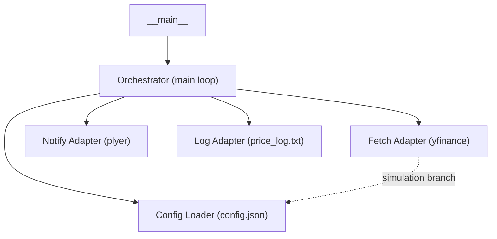
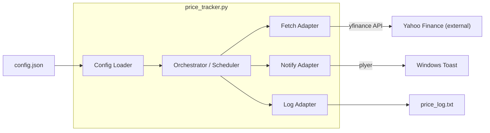

# Architecture Spine — Bank of Baroda Price Tracker & Alerter

## Design Paradigm

**Layered Adapter** — a single-file MVP whose responsibility layers never reach across each other:

```
┌─────────────────────────────────────────┐
│  Entry Point  (price_tracker.py __main__)│
├─────────────────────────────────────────┤
│  Orchestrator (main loop + scheduler)   │
├──────────┬──────────┬───────────────────┤
│  Fetch   │  Notify  │  Log              │
│ Adapter  │ Adapter  │ Adapter           │
├──────────┴──────────┴───────────────────┤
│  Config Loader  (config.json reader)    │
└─────────────────────────────────────────┘
```

Each adapter owns exactly one external concern. The orchestrator calls adapters; adapters never call each other.



## Invariants & Rules

### AD-1 — Layered separation: I/O in adapters, logic in orchestrator

- **Binds:** all modules
- **Prevents:** mixing network/file/notification calls with scheduling or threshold logic
- **Rule:** all external I/O (`yfinance`, `plyer`, file writes) lives in adapter functions/classes; the orchestrator loop calls only pure functions and adapter interfaces — never a library directly

### AD-2 — Language & runtime baseline

- **Binds:** all modules
- **Prevents:** accidental use of syntax unsupported on the target Windows host
- **Rule:** Python ≥ 3.10 (CPython, Windows 10/11); `X | Y` union hints and `match` are permitted; no features above 3.10 without an explicit version bump

### AD-3 — Configuration as single source of truth [ADOPTED]

- **Binds:** orchestrator, all adapters
- **Prevents:** hardcoded magic numbers (threshold, interval, test_price) scattered across source
- **Rule:** every user-tunable value is read from `config.json` at startup via the Config Loader; no literal threshold or interval appears in orchestrator or adapter code

### AD-4 — Adapter error isolation

- **Binds:** fetch adapter, notify adapter, log adapter
- **Prevents:** an unhandled exception in any adapter crashing the process
- **Rule:** each adapter wraps its call in a try/except; failures return `None` or log and return silently; the orchestrator catches `None` / logged failures and retries after `CHECK_INTERVAL` — the loop never exits on an adapter error

### AD-5 — Scheduling ownership in orchestrator only

- **Binds:** orchestrator
- **Prevents:** adapters duplicating or contradicting market-hours logic
- **Rule:** the `is_market_open()` guard lives exclusively in the orchestrator; adapters are always-on and stateless with respect to time

### AD-6 — Simulation mode encapsulated in fetch adapter

- **Binds:** fetch adapter
- **Prevents:** test-mode branching leaking into the orchestrator or other adapters
- **Rule:** when `simulation_mode=true`, the fetch adapter returns `config.test_price` without any network call; the orchestrator is unaware of simulation state

## Consistency Conventions

| Concern | Convention |
|---|---|
| Naming (files, functions) | `snake_case` for all Python identifiers; single source file `price_tracker.py` for MVP |
| Config keys | `snake_case` JSON keys; all caps constants in Python (`THRESHOLD`, `CHECK_INTERVAL`) |
| Log format | `YYYY-MM-DD HH:MM, {price:.2f}` — one line per poll, appended to `price_log.txt` |
| Error logging | `print(…, file=sys.stderr)` for adapter errors in MVP; no external logging framework |
| Timestamps | `datetime.now()` (local time, assumed IST per host clock); no tz-aware objects in MVP |
| Return conventions | Adapter functions return typed value or `None` on failure — never raise to orchestrator |

## Stack

| Name | Version |
|---|---|
| Python (CPython) | ≥ 3.10 |
| yfinance | ≥ 0.2 (latest stable) |
| plyer | ≥ 2.1 |
| Standard library only (datetime, json, time, pathlib, sys) | built-in |

## Structural Seed

```text
BMAD_Project/
  price_tracker.py        # entry point + orchestrator + all adapters (single-file MVP)
  config.json             # user-tunable values (threshold, simulation_mode, test_price)
  requirements.txt        # yfinance, plyer
  price_log.txt           # runtime output — appended each poll (not committed to VCS)
  bmad-output/
    planning-artifacts/
      architecture/
        architecture-BMAD_Project-2026-07-16/
          ARCHITECTURE-SPINE.md
          .memlog.md
  .bmad/
    shards/               # PRD shards (one per functional area)
```



## Capability → Architecture Map

| Capability / FR | Lives in | Governed by |
|---|---|---|
| FR-1 Fetch Current Price | Fetch Adapter | AD-1, AD-4, AD-6 |
| FR-2 Time-Window Enforcement | Orchestrator (`is_market_open`) | AD-5 |
| FR-3 Threshold Alert | Notify Adapter (called by orchestrator) | AD-1, AD-4 |
| FR-4 Logging | Log Adapter | AD-1, AD-4 |
| FR-5 Configurable Threshold | Config Loader + AD-3 | AD-3 |
| FR-6 Simulation Mode | Fetch Adapter | AD-6 |
| FR-7 Retry on Failure | Orchestrator loop | AD-4, AD-5 |

## Deferred

- **Log rotation policy** — not decided; the PRD flags it as Open Question 2. Deferred until the project sees real log growth or user requests it.
- **Multi-ticker support** — explicitly out of scope for MVP (Non-Goals §5).
- **Holiday-aware scheduling** — weekend check only; full NSE holiday calendar deferred post-MVP.
- **Async / non-blocking I/O** — synchronous `time.sleep` loop is sufficient for a single-ticker, 5-minute interval; async deferred until multi-ticker or sub-minute polling is needed.
- **Packaging / distribution** — PyInstaller or Windows Task Scheduler integration deferred to post-MVP deployment story.
- **Cross-platform notifications** — macOS/Linux support deferred (Non-Goals §5).
